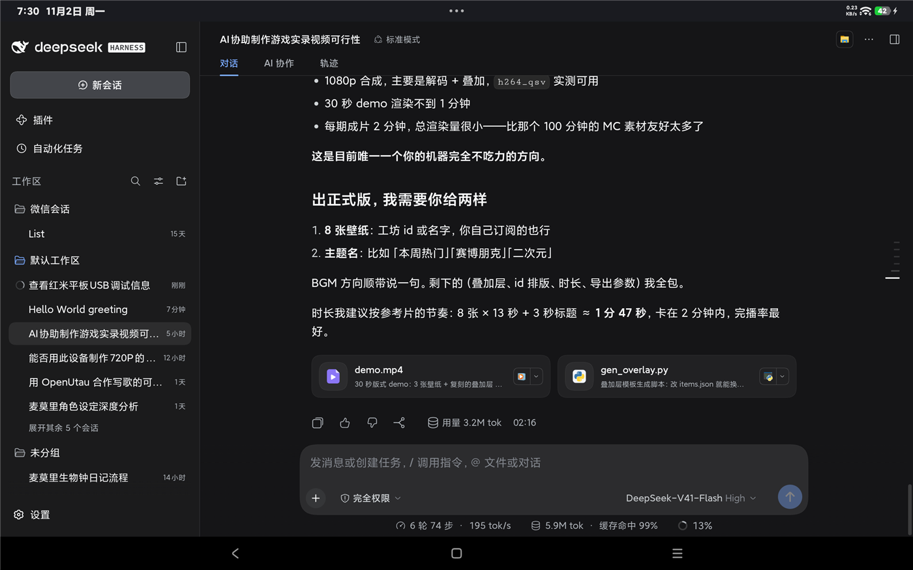

# DSH LAN Pair

把电脑上的 [DeepSeek Harness](https://github.com/deepseek-ai/deepseek-harness) 网页界面，
安全地开放给同一个局域网里的手机/平板使用。



- **插件端**（`dsh-lan-pair`）：在 DSH 进程内起一个局域网监听，反向代理到本机回环，
  自动完成 DSH 的 token 交换并把会话 cookie 自己拿着。**手机永远拿不到 DSH 的启动 token。**
- **App 端**（DSH LAN）：自动发现局域网里的 DSH 电脑，输入一次 **4 位配对码**，之后打开即连，
  用系统 WebView 全屏显示界面。
- **默认不可见**：不点「开启配对」，这台电脑根本不会出现在局域网里。

手机端不需要 root、不需要 USB 调试、不需要自己拼 URL。

---

## 快速开始（三步）

1. **电脑**：把插件装进 DSH 的 profile，在 `bundles` 里登记，重启 DSH（见下面「安装插件」）
2. **电脑**：DSH **设置 → 移动设备 → 开启配对**，会弹出一个窗口显示 **4 位数字**
3. **手机**：装好 App，列表里点这台电脑，输入那 4 位数字 → 连上

之后每次打开 App 都自动连，不需要再输入任何东西。

> 分享给别人时提醒两件事：手机需要允许「安装未知来源的应用」；
> 首次连接如果 Windows 弹出防火墙提示，要允许（只放行那一个 TCP 端口即可）。

---

## 为什么需要它

`dsh web` 出于安全考虑**只监听 127.0.0.1，并明确拒绝 `--host 0.0.0.0`**。
它的会话 cookie 还带 `SameSite=Strict`，所以任何浏览器用"外部链接"打开都会得到
`HTTP 401 dsh web authentication required`。

这个插件把这两件事一起解决：自己开一个局域网端口，自己持有 cookie，
手机只跟插件说话。

---

## 安装插件

前提：已经装好 DSH（本插件在 `0.1.7-rc.2` 上验证过），并且有一个 web profile。

### 1. 把包装进 profile

`<profile>` 是你的 profile 名。**用官方桌面版启动器时，profile 名通常就是 DSH 的版本号**
（例如 `0.1.7-rc.2`）；如果你自己用 `dsh web` 起的，一般是 `web`。

```bash
# 进入 profile 目录，例如 Windows：
#   cd %USERPROFILE%\.dsh\profiles\0.1.7-rc.2
pnpm add github:FORGE-131/dsh-lan-pair#v0.2.3
```

想从本地目录安装（改代码调试时）就用 `pnpm add link:/path/to/dsh-lan-pair`。

### 2. 在 bundles 里登记

编辑 `$DSH_HOME/profiles/<profile>/package.json`，把包名加进 `dsh.profile.bundles`：

```json
{
  "dsh": {
    "profile": {
      "bundles": [
        "@deepseek-ai/dsh-base",
        "@deepseek-ai/dsh-web-app",
        "dsh-lan-pair"
      ]
    }
  }
}
```

本包自带 `cordis.patch.yml`，登记后会自动生效，**不需要手动改 patch 文件**。

### 3. 重启 DSH

启动日志里应该出现：

```
[dsh-lan-pair] listening on 0.0.0.0:8099 -> 127.0.0.1:10723
[dsh-lan-pair] pairing is off until you open a window (DSH settings -> 移动设备)
```

**默认不广播**：在你点「开启配对」之前，手机扫描不到这台电脑。

如果 Windows 防火墙弹出提示，请允许；或者手动放行这一个 TCP 端口（只对本子网）：

```powershell
netsh advfirewall firewall add rule name="DSH LAN Pair" dir=in action=allow protocol=TCP localport=8099 profile=private,domain remoteip=LocalSubnet
```

---

## 配对流程（4 位码）

1. 在电脑上打开 DSH 的 **设置 → 移动设备**，点 **开启配对**
2. 电脑会弹出一个窗口显示 **4 位数字**，同时这台机器才开始在局域网里广播
3. 在平板 App 里输入这 4 位数字
4. 配对成功后窗口自动关闭、广播停止，App 拿到长期凭据，以后打开即连

配对码的规则：**两分钟有效、只能使用一次、输错 5 次即作废**。因为码只有 4 位，
这些限制是必需的——否则一万种组合几秒就能试完。

不用手输长密钥。如果确实需要（例如 App 出问题），长期密钥仍然可作为后备：

```
$DSH_HOME/lan-pair.json      # 例如 C:\Users\<you>\.dsh\lan-pair.json
```

```json
{ "secret": "bfrVhwqHdzue50xo", "createdAt": "2026-11-01T21:40:07.737Z" }
```

删掉这个文件再重启 DSH 就会换一个新的。环境变量优先级更高：

| 变量 | 作用 |
|---|---|
| `DSH_LAN_PAIR_SECRET` | 覆盖长期密钥 |
| `DSH_LAN_PAIR_PORT` | 覆盖端口（默认 8099） |
| `DSH_LAN_PAIR_PUBLIC_URL` | 固定公网地址（命名隧道 / 反向代理时填） |
| `DSH_LAN_PAIR_TUNNEL` | 自动拉起隧道的命令，插件从输出里抓公网地址 |
| `DSH_LAN_PAIR_TTL_MS` | 配对码有效期（默认 120000） |
| `DSH_LAN_PAIR_DEBUG` | 输出 mDNS 报文诊断日志 |

不开配对窗口时，也可以手动访问 `http://127.0.0.1:<端口>/lanpair/open` 来开启。

---

## 远程访问（不在同一个局域网）

配对本身是永久的：长期密钥不会过期，换网络**不需要重新配对**。
但 App 记住的是「地址」，所以出门时需要一个从外网能到达的地址。两种方式：

### 方式一：让插件托管隧道

```powershell
# 插件启动时自动拉起隧道，并从输出里抓公网地址
$env:DSH_LAN_PAIR_TUNNEL = "cloudflared tunnel --url http://127.0.0.1:8099 --no-autoupdate"
```

### 方式二：填一个固定地址（命名隧道 / 反向代理）

```powershell
$env:DSH_LAN_PAIR_PUBLIC_URL = "https://dsh.example.com"
```

### 查当前可用地址

插件在 DSH 源上提供：

```
GET /lanpair/info
```

```json
{
  "ok": true,
  "port": 8099,
  "lan": ["http://192.168.1.14:8099"],
  "publicUrl": "https://xxx.trycloudflare.com",
  "pairLink": "https://xxx.trycloudflare.com/__pair?k=...",
  "lanPairLink": "http://192.168.1.14:8099/__pair?k=...",
  "tunnel": { "running": true, "url": "https://xxx.trycloudflare.com" }
}
```

### 多地址自动切换

插件会把 `publicUrl` 写进 mDNS 的 TXT 记录（`remote=`）。
App 在局域网发现电脑时，会同时拿到**局域网地址和远程地址**，并存成端点列表：

```
连接时按顺序探测（3 秒超时）：
  1. 局域网地址   ← 在家秒连，不绕公网
  2. 远程地址     ← 出门自动启用
```

第一个通的就用，无需手动切换。

### 深链接（可做成二维码 / 快捷方式）

```text
dshlanpair://connect?base=<地址>&remote=<备用地址>&fallback=<再备用>&k=<密钥>
dshlanpair://pair?u=<urlencode 的完整 __pair 链接>
```

例如，一个同时带局域网和隧道的链接：

```text
dshlanpair://connect?base=http%3A%2F%2F192.168.1.14%3A8099&remote=https%3A%2F%2Fxxx.trycloudflare.com&k=<密钥>
```

扫一下或点一下即可连接，不用手输地址。

> 注意：Cloudflare 的**快速隧道**（`trycloudflare.com`）域名每次重启都会变，且同一出口 IP
> 并发建立多个隧道会被限流。长期使用请配**命名隧道**或用 `DSH_LAN_PAIR_PUBLIC_URL` 指向固定域名。

---

## 安装 App

从 Releases 下载 `dsh-lan-pair-<version>.apk`，侧载安装（需要允许"未知来源"）。

- 最低 Android 8.0（API 26），未限制 CPU 架构（不含原生库）
- 体积约 45 KB，用系统自带的 WebView 渲染，支持 `https://` 远程地址与深链接，不打包浏览器内核
- 应用签名是自签名证书（`CN=DSH LAN Pair`），不是商店签名

## 使用

1. 电脑上：DSH 设置 → **移动设备** → **开启配对**
2. 平板上打开 **DSH LAN**，列表里出现这台电脑（例如 `DESKTOP-I9IRUS8 (win32) 192.168.1.14:8099`）
3. 输入电脑上弹出的 4 位数字，点 **连接**
4. 之后每次打开 App 都会自动连；想换电脑就按返回键调出连接面板

如果扫描不到，确认电脑上已经点了「开启配对」（不点就不广播）；
也可以直接在地址栏手动填 `IP:端口`。

---

## 故障排查

| 现象 | 原因与处理 |
|---|---|
| App 显示"密钥不对" | 密钥过期或换了 `lan-pair.json`，重新复制一次 |
| App 显示"连不上" | 电脑上 DSH 没启动、不在同一 Wi-Fi、或防火墙拦了 8099 |
| 扫描一直空 | 路由器开了 AP 隔离 / 客户机隔离；改用 Adb 或手动填地址 |
| 启动时报 8099 被占用 | 已经有一个 DSH 实例在跑；同一个 profile 只应有一个实例 |
| 更新 DSH 后插件失效 | 见下方兼容性说明 |

## 兼容性

插件依赖 DSH 内部的 `connection` 与 `webServer` 两个服务名，以及
`connection.authenticatedUrl()`。这些**不是公开稳定 API**，DSH 升级后可能变化。
请在 `package.json` 的 `peerDependencies` 里锁定你验证过的 DSH 版本。

已验证组合：DSH `0.1.7-rc.2` + Android 15/16 (HyperOS)。

## 从源码构建 App

不需要 Android Studio 或 Gradle，只用四样东西：`aapt2`、`d8`、`zipalign`、`apksigner`
（来自 Android build-tools）加一个 `android.jar`。

```powershell
# 一次性准备（示例路径，见 android/build.ps1 顶部变量）
#   C:\Users\<you>\android-tools\build-tools\android-14\
#   C:\Users\<you>\android-tools\platform\android-35\android.jar
#   C:\Users\<you>\android-tools\r8-<version>.jar

powershell -ExecutionPolicy Bypass -File android\build.ps1
# 产物：android\dist\dsh-lan-pair-<version>.apk
```

两个已知坑，脚本里已处理：

1. `build-tools r34` 自带的 **R8 8.2 会在任何带 `EnclosingMethod` 属性的类上崩**（也就是 javac 生成的
   每一个匿名类），报 `NullPointerException: String.length() parameter1 is null`。
   解决办法是从 Google Maven 取一个独立的 R8 jar（`dl.google.com/android/maven2`）来跑 dex。
2. **JDK 25 会让老 R8 挂掉**，构建用便携式 JDK 21。
3. 给 `package.json` 写文件时不要带 BOM，`pnpm` 会报 `Invalid package.json`。

## 开发工具

```bash
# 独立验证 mDNS 广播（发真实 PTR 查询并自行解码）
node tools/mdns-probe.mjs 6
node tools/mdns-probe.mjs 6 127.0.0.1   # 本机单播自检
```

## 安全说明

配对密钥只是**防误连**，不是强加密：局域网内明文 HTTP，能抓包的人也能拿到会话。
它解决的是"同一个 Wi-Fi 下的邻居随手打开就能指挥你的电脑"这一类意外暴露。
如果需要真正安全，请自行套 TLS 反向代理。

## License

MIT
